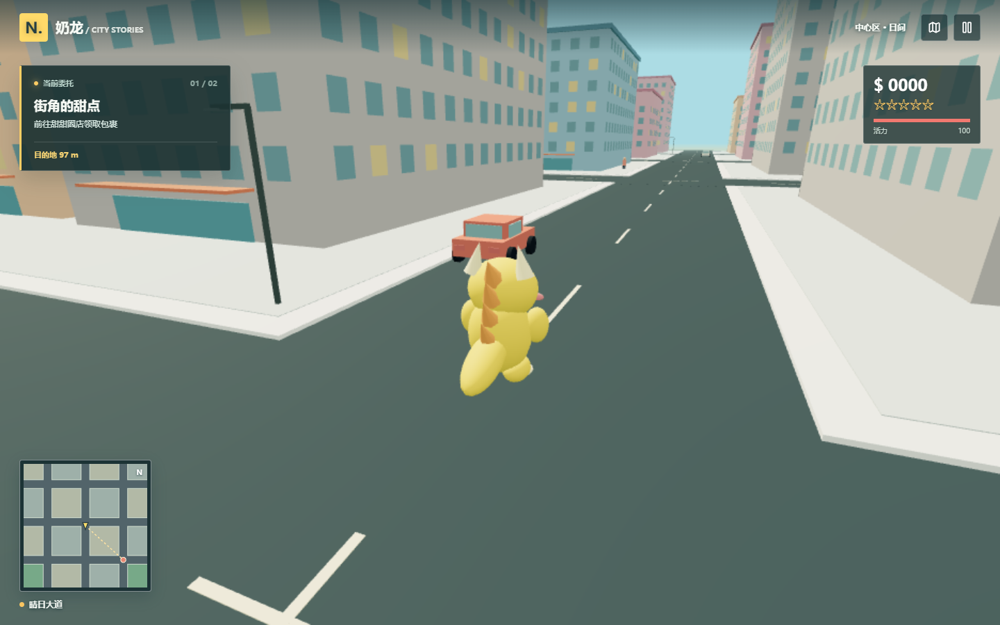

# 奶龙：城市漫游 / Nailong City

一款可离线运行的第三人称城市沙盒小游戏。程序化街区、海滨和公园，可步行、驾驶、接取两段限时配送任务、体验交通与巡逻追逐。角色、车辆、建筑和街景由代码建模，未包含《GTA 5》的地图、音频、图像、代码或商标素材。



这是一款小型独立游戏，不是《GTA 5》的完整复刻，也不隶属于 Rockstar Games 或“奶龙”形象的权利方。发布和再利用角色名称或形象前，应自行确认使用权。

## 下载运行

Windows 10/11 x64 双击 `Nailong-City-0.1.0-x64.exe` 即可运行，无需安装 Node.js 或联网。若系统提示未知发布者，需要自行确认文件来源。游戏进度自动保存在本机；首次启动需要可用的图形加速环境。

## 操作

| 操作 | 按键 |
| --- | --- |
| 移动、驾驶 | WASD |
| 奔跑 | Shift |
| 跳跃、驾车刹车 | 空格 |
| 上下车、修理站互动 | E |
| 驾车时在修理站修理 | G |
| 彩弹 | 鼠标左键 |
| 转动镜头 | 点击画面后移动鼠标 |
| 地图 | M |
| 暂停、设置与重新开始 | Esc |

触屏提供方向摇杆和动作按钮。靠近地图标记后自动领取或交付包裹。巡逻等级随碰撞和彩弹事件上升，远离追逐后逐渐消退。

## 源码构建

需要 Node.js 20.19+、Windows x64。进入项目目录：

```powershell
npm install
npm run dev
npm test
npm run dist
```

可执行文件输出在 `release/`。`npm run dev` 启动本地开发页面；`npm run build` 生成离线网页；`npm start` 用 Electron 打开已构建页面。

使用 Three.js 进行渲染、cannon-es 进行碰撞、Vite 构建、Electron 包装。项目自己的源代码采用 MIT 许可；依赖及其许可归各自作者所有。游戏名称与任何第三方角色权利均不在本项目许可证授予范围内。
